# Scalable MPC Framework for Privacy-Preserving Profile Updates

A two-party secure computation (MPC) system that lets a matrix-factorization-style
recommender (user profiles `U`, item profiles `V`) be **updated from user feedback without
either server ever learning which item a user interacted with, or the plaintext value of
any profile vector.**

Both servers only ever see additive/XOR secret shares. Which item index was queried is
hidden from both servers using a **Distributed Point Function (DPF)** — the query is
expanded into a one-hot selection vector inside each server's share space, so no single
server can tell which coordinate was selected. The actual multiplication `U_i · V_j`
needed for the profile update is computed jointly using the **DU–Atallah** secure
multiplication protocol, entirely over secret shares.

This repo contains the full protocol implementation (C++, socket-based two-party
computation) plus a Flask dashboard that runs the real binaries and visualizes protocol
state live, for demonstration purposes.

## Contents

```
repo-root/
├── build.sh                  ← compiles all backend binaries (run this first)
├── mpc-protocol/              ← the C++ MPC backend
│   ├── Gen_queries/            query generation + DPF key generation
│   ├── Communication/          DU–Atallah correlated-randomness preprocessing
│   ├── files/party0/, party1/  the two non-colluding servers
│   ├── Updater/                reconstructs & verifies U, V after an update
│   ├── Main/                   CLI orchestrator (runs the full pipeline in order)
│   ├── globalfiles/            shared query/matrix files
│   ├── Dockerfile, docker-compose.yaml
│   └── build.sh removed — use the root-level build.sh instead
├── frontend/                  Flask dashboard that drives the real binaries
│   ├── app.py, requirements.txt
│   ├── templates/, static/
│   └── README.md               frontend-specific setup notes
└── docs/report-figures/       benchmark charts (see Results below)
```

## How the protocol works

1. **Query generation** (`run1`, `Gen_queries/gen_queries.cpp`) — generates the initial
   secret shares of the profile matrices `U` and `V`, split across the two parties.
2. **DPF key generation** (`run2`, `Gen_queries/dpf_user.cpp`) — for each update query, the
   user reads the target item index `j`, builds a DPF with payload `0`, and samples two
   DPF keys (one per server).
3. **Preprocessing** (`run3`, `run4`, `Communication/`) — generates and distributes the
   correlated randomness (Beaver-style tuples) needed for the DU–Atallah secure
   multiplication used later.
4. **Server computation** (`run5` = Party 0, `run6` = Party 1, run in parallel over sockets):
   - Each server replaces the DPF payload with `1` and expands its DPF key to obtain a
     one-hot vector selecting index `j` — without learning `j` itself.
   - The XOR-shares from the DPF expansion are converted to additive shares.
   - Servers compute shares of `U_i · V_j` using **DU–Atallah** multiplication.
   - They compute shares of `1 − U_i·V_j`, then dot that with their `U_i` shares to get `M_i`.
   - Servers mask `M_i` into `P_i`, exchange the masked values, and reconstruct
     `FCW_m = P_0 + P_1`.
   - Both servers update their share of `V`: `V_b ← V_b + EvalFull(k_b)`.
   - Both servers also update their shares of `U` (using the corrected, socket-based
     Assignment 1 logic — see **Development history** below).
5. **Verification** (`run7`, `Updater/FinalUiUpdater.cpp`) — reconstructs and prints the
   updated `U` and `V` matrices so correctness can be checked. In the real protocol this
   reconstruction step would not exist; it's included purely for demo/verification.
6. **Orchestration** (`Main/main.cpp`) — runs stages 1–5 in order, launches both servers as
   parallel threads (Party 0 starts first, Party 1 follows after a short delay, then the
   orchestrator joins both), and prints labelled `U0`, `U1`, reconstructed `U`, `V0`, `V1`,
   reconstructed `V` for verification.

**Design properties:** parallel execution of the two servers, deterministic and
reproducible runs, and easy correctness verification via the printed/reconstructed output.

## Development history — corrections from earlier iterations

This implementation is the corrected, integrated version of three earlier pieces of work.
Documenting the mistakes and fixes here because they're informative about what actually
matters in an MPC implementation:

**Server communication (originally missing sockets)**
- *Problem:* the original implementation computed updates correctly but didn't use real
  sockets between servers — it didn't replicate an actual distributed deployment.
- *Fix:* server-to-server communication now happens over real sockets, with each party
  implemented as its own standalone process/binary (`party0.cpp`, `party1.cpp`).

**Unbounded values**
- *Problem:* share values weren't bounded to any field, so they grew unboundedly (overflow
  risk) after a few query executions.
- *Fix:* all values are now bounded in a field of size `2^64`.

**DPF generator (originally returned leaves, not keys)**
- *Problem:* `dpf_generator` returned only leaf values instead of proper DPF keys and
  control words — and `evalfull` merely XOR-checked leaves instead of expanding the full
  DPF tree, because the original implementation treated `evalfull` as a verifier rather
  than a full DPF evaluator.
- *Fix:* `dpf_generator` now returns keys + control words, and `evalfull` correctly expands
  the complete DPF tree. This corrected DPF implementation is what's used throughout this
  repo's `Gen_queries/` and server code.

The net result is that this repo represents the **integrated and corrected** implementation
— the socket-based, field-bounded server logic and the corrected DPF evaluator are used
directly inside `party0.cpp` / `party1.cpp` and the rest of the pipeline described above.

## Results

All benchmarks were run on an Intel Core i5-10500H (6 cores / 12 threads, 2.50 GHz base
clock, dynamic scaling between 0.8–2.5 GHz), 64-bit x86_64, little-endian. Each profile
vector has 64 features (`k = 64`) throughout.

### User profile update time vs. number of queries
`m = 100` users, `n = 1` item (isolates the effect of query count `Q`).

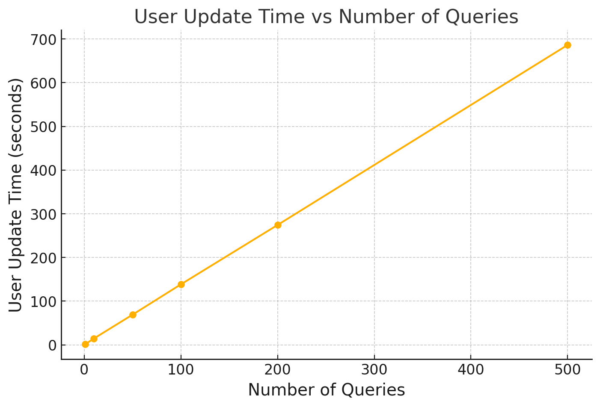

Time scales **linearly** with `Q`: `T(Q) ≈ Q · c`, where `c` is the amortized per-query
cost. Across `Q ∈ {1, 10, 50, 100, 200, 500}`, the ratio `T(Q)/Q` stays close to a constant
**≈1.37 seconds/query**. This means: predictable performance (cost per query stays flat),
no hidden bottleneck (no step like aggregation or network sync dominates as load grows),
and the design is deployable at scale since compute grows proportionally with usage.

### User profile update time vs. number of users
`Q = 100` queries, `n = 2` items — isolates the effect of total user population size.

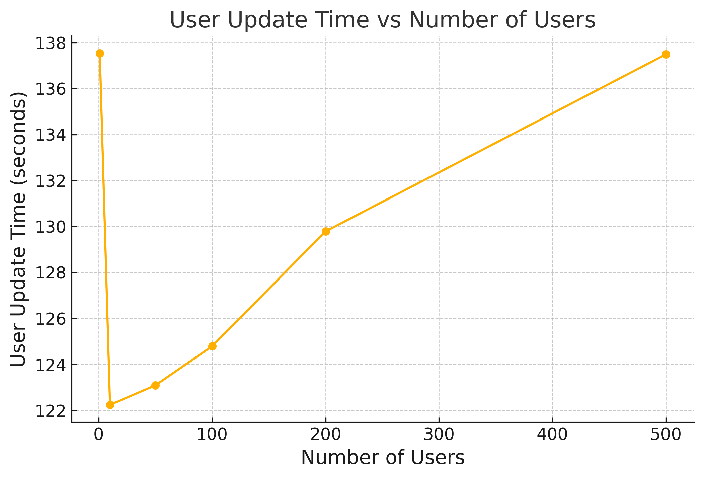

Update time for a *single* user stays in a narrow band (**≈122–138 s**) as the total user
count grows from 1 to 500 — i.e. it's essentially **independent of how many users are in
the system**. This implies the protocol avoids any global state aggregation or
user-count-dependent overhead, and that per-update cost is dominated by fixed
per-query cryptographic work rather than system-wide factors.

### User profile update time vs. number of items
`m = 100` users, `Q = 100` queries — isolates the effect of catalog size.

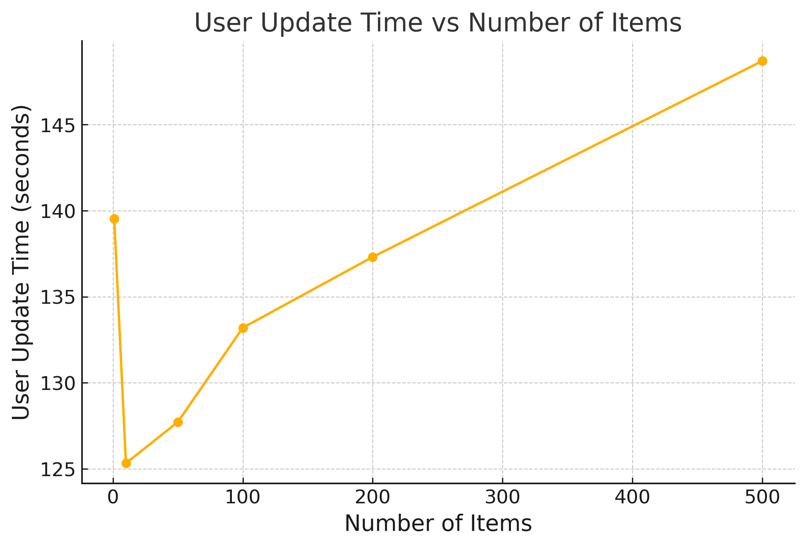

Time grows only mildly as item count goes from 1 to 500 (**≈125–148 s**), a smooth and
gradual increase — item-dependent operations are lightweight relative to total update
cost, and the protocol handles large catalogs without degradation.

### Item profile update time vs. number of queries
`m = 2` users, `n = 50` items — isolates query load's effect on an *item* update.

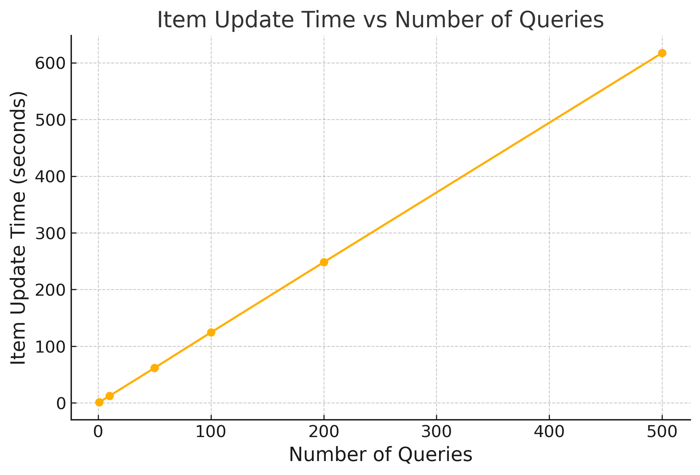

Same linear relationship as the user-side case: **≈1.3 s → ≈620 s** as `Q` goes from 1 to
500, matching the theoretical `O(Q)` complexity of the underlying cryptographic
computations, with no saturation or overhead spikes even at high query volume.

### Item profile update time vs. number of items
`m = 2` users, `Q = 100` queries — isolates catalog size's effect on an item update.

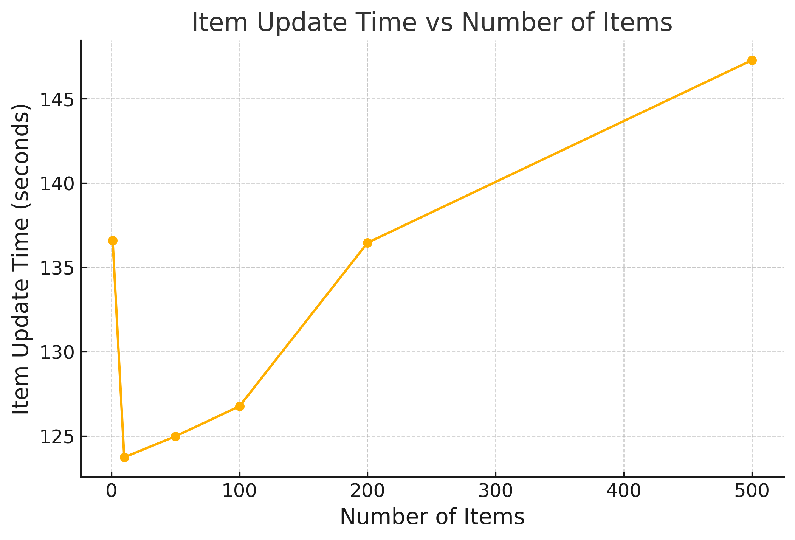

Gradual growth from **≈124 s → ≈147 s** as items scale 1→500 — smooth, monotonic, no
sudden jumps, useful for capacity planning as a catalog grows.

### Item profile update time vs. number of users
`n = 50` items, `Q = 100` queries — isolates user population's effect on an item update.

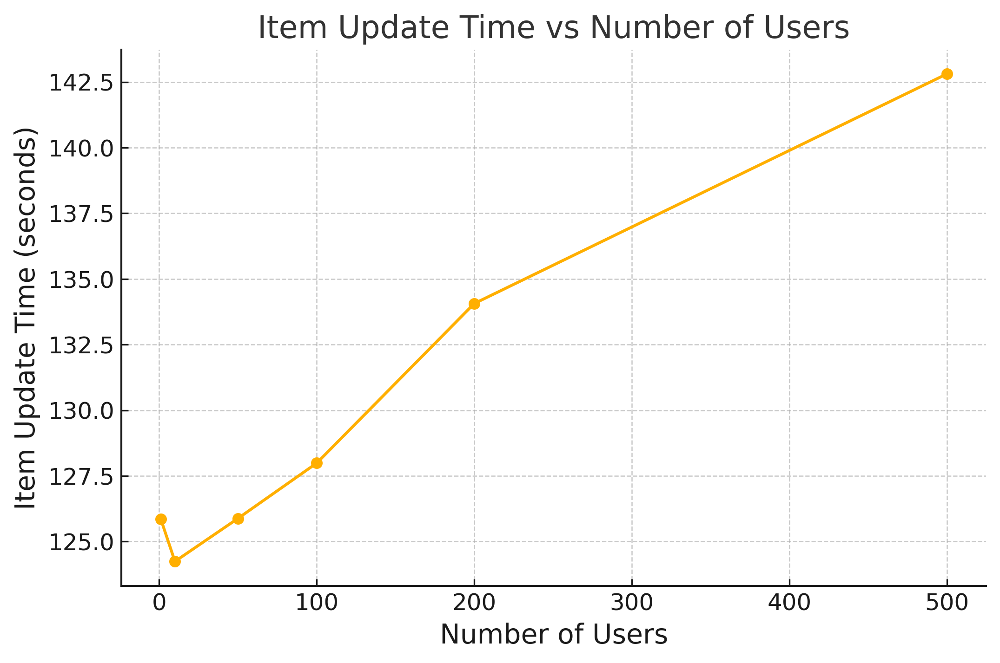

Nearly flat: **≈124 s → ≈143 s** as user count scales 1→500, confirming item updates are
dominated by fixed per-item/per-query computation rather than any user-count-dependent
step.

### Takeaways
- **Query count (`Q`) is the dominant cost driver**, and it scales linearly and
  predictably — no hidden superlinear behavior anywhere in the pipeline.
- **User count and item count barely matter** to the cost of a single update — the
  protocol has no global-state aggregation step, which is what makes it viable at scale.
- All six experiments together indicate a system whose performance is governed almost
  entirely by per-query cryptographic cost, which is the property you want from an MPC
  system meant to support large, growing user/item populations.

## Live dashboard

A Flask-based dashboard (`frontend/`) runs the real compiled binaries in the same order
`Main/main.cpp` does, and visualizes live protocol state by reading the same files the C++
code reads and writes. **It doesn't reimplement any cryptography** — it's a thin bridge
that shells out to the binaries and streams progress to the browser.

### How it actually works

`frontend/app.py` is a single-file Flask backend built around one generator function,
`pipeline(m, n, k, q)`, that mirrors `Main/main.cpp`'s control flow stage-for-stage:

1. **Init** — runs `run1` (`Gen_queries/gen_queries.cpp`) to generate fresh `U`, `V`, and
   both parties' initial shares, then reads all of those straight off disk
   (`globalfiles/U.txt`, `globalfiles/V.txt`, `files/party0/U0_party0.txt`, etc.) so the
   browser can show the real starting state.
2. **Per query, for each of the `q` queries generated:**
   - **DPF stage** — runs `run2` to build the DPF query key for that query's item index.
   - **Preprocessing stage** — runs `run3` then `run4` (the Beaver-style correlated
     randomness needed for DU–Atallah).
   - **Exchange stage** — launches `run5` (Party 0) and `run6` (Party 1) as two real OS
     threads, with Party 0 given a one-second head start so it can bind its socket before
     Party 1 connects. Both are joined before continuing. Exchange time is measured only
     from after that bind delay, so the reported number reflects actual socket exchange
     time, not artificial startup latency.
   - **Update stage** — runs `run7` to apply the secret-shared update and re-reads both
     parties' share files plus the reconstructed `U`/`V` off disk.
   - Each of these five sub-stages pushes a **Server-Sent Event** to the browser the
     moment it completes, which is what drives the pipeline stepper animating live.
3. **Complete** — emits final aggregate stats: total wall-clock time, average per-query
   exchange time, and average exchange payload size (computed from the actual bytes
   written into each party's `Recieved/`, `Recieved2/`, and `last_item/` folders — i.e. the
   files each party genuinely writes to disk for the other party during a real exchange,
   not a simulated number).

`/api/run` streams that generator directly as `text/event-stream`; a `threading.Lock`
ensures only one protocol run executes at a time, since the C++ side reads and writes
fixed file paths and a second concurrent run would corrupt shared state. `/api/status`
checks on load whether all seven binaries exist and disables the "Run protocol" button
with a clear message if any are missing.

See [`frontend/README.md`](frontend/README.md) for local setup instructions.

### Screenshots

**Landing page** — states the threat model up front: two-party additive secret sharing,
semi-honest and non-colluding parties, and what that guarantees (a single party's share is
uniformly random and reveals nothing about the real value on its own).


**Run configuration + live pipeline** — set `m`, `n`, `k`, `q` and watch the five stages
above light up in real time as their SSE events land, alongside live stats (average
exchange time, payload size per query, queries run).

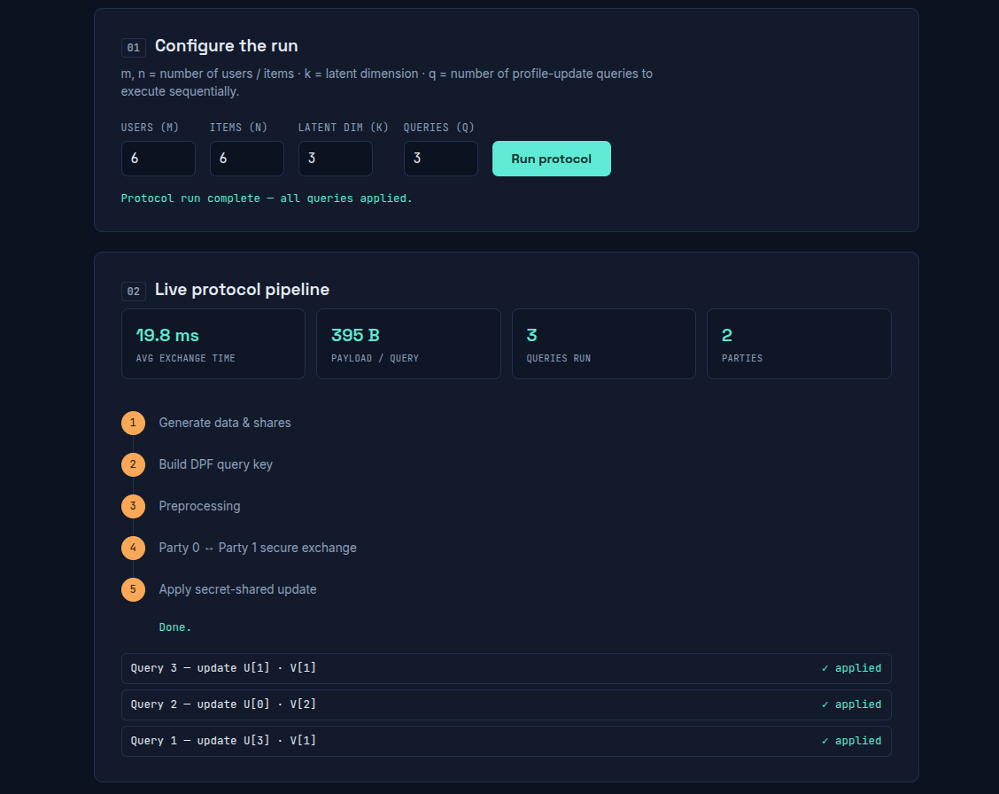

**What each party actually holds** — reads each party's `U`/`V` share files directly off
disk and displays them side by side. On their own, both grids are just noise — that's the
point.

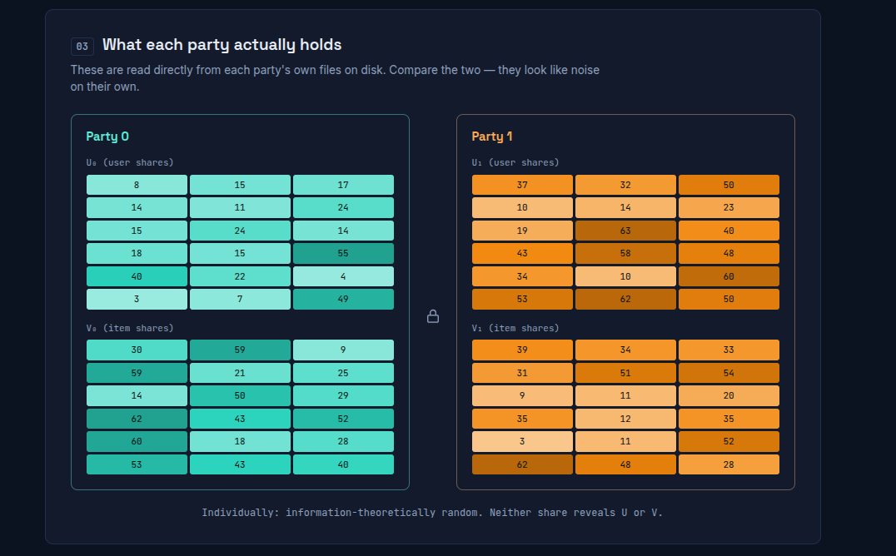

**Ground truth panel** — reconstructs `U = U0+U1` and `V = V0+V1` purely for the demo, so a
viewer can confirm correctness. Clearly marked as debug/verification-only: nothing in the
real protocol ever computes this, since no single party (or the dashboard, in a real
deployment) should ever hold both shares at once.

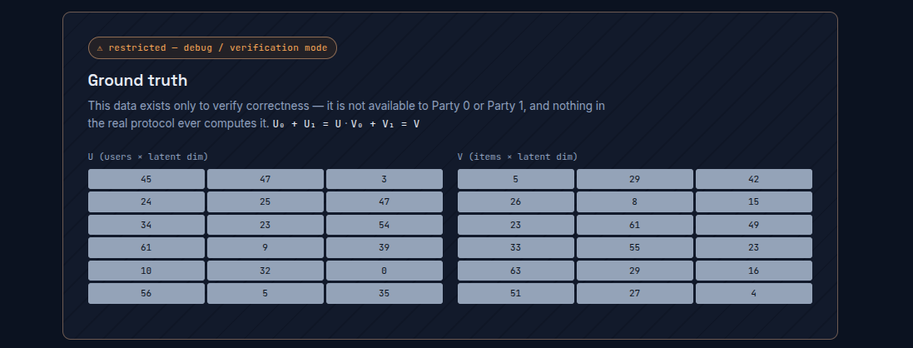

**Insider-threat simulation** — the most useful part of the dashboard for explaining *why*
the design works, not just that it does. Lets a viewer "play attacker" and breach one
party's server outright (full read access to every file on disk):

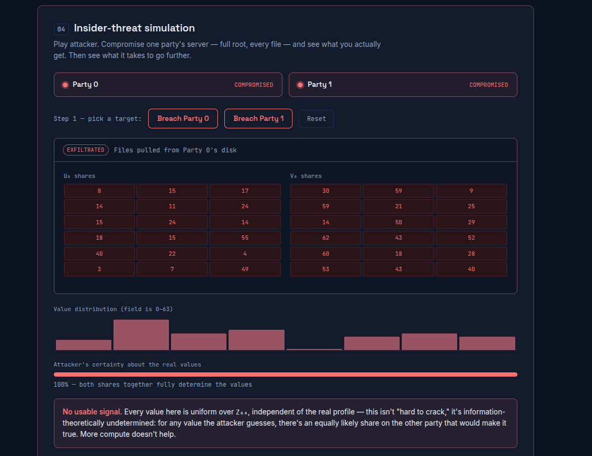

Breaching one party alone yields nothing usable — every value is uniform over the field
(`Z_2^64`), so the exfiltrated share is information-theoretically independent of the real
profile. Only breaching **both** independently-operated parties at once reconstructs the
real data, which is exactly the non-colluding assumption the whole security model rests
on:

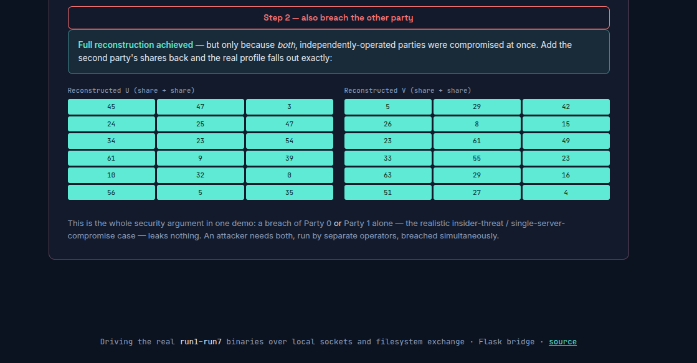

## Setup

### 1. Build the C++ backend

Requires a C++17 toolchain (`g++`) and `pthread`.

```bash
./build.sh
```

This compiles all seven pipeline binaries plus the standalone CLI (`Main/main`) directly
next to their source files, exactly like the project's `Dockerfile` does. Binaries are
**not** committed to this repo (see `.gitignore`) — always build locally first.

Prefer Docker? The original `Dockerfile` and `docker-compose.yaml` are still in
`mpc-protocol/` and build the same binaries inside a container:

```bash
cd mpc-protocol
docker compose build
docker compose run --rm mpc_app ./main <m> <n> <k> <q>
```

If that doesn't work on your system, run it manually instead:

```bash
docker compose up -d
docker exec -it mpc_project bash
./main <m> <n> <k> <q>      # once inside the container
exit
docker compose down
```

### 2. Run the dashboard

```bash
cd frontend
python3 -m venv .venv
source .venv/bin/activate      # on Windows: .venv\Scripts\activate
pip install -r requirements.txt
python3 app.py
```

Then open **http://localhost:5050**. The dashboard checks on load whether all binaries
built successfully and disables the "Run protocol" button with a clear message if any are
missing.

### 3. Run the protocol standalone (no dashboard)

```bash
cd mpc-protocol/Main
./main <m> <n> <k> <q>
```
where `m` = number of users, `n` = number of items, `k` = number of profile features, and
`q` = number of update queries to run.

## Notes

- All intermediate protocol state (secret shares, DPF control words, masked values) is
  written to disk under `mpc-protocol/files/party0/` and `party1/` as plain `.txt` files —
  this is intentional for the demo/dashboard, and reflects exactly what each party would
  hold in a real deployment (just persisted to disk instead of memory).
- Every full run regenerates `U`, `V`, and both parties' shares from scratch (`run1`'s
  behavior), so each run is a clean new scenario.
- Only one protocol run executes at a time — the C++ side uses fixed file paths, so
  concurrent runs would corrupt shared state.
